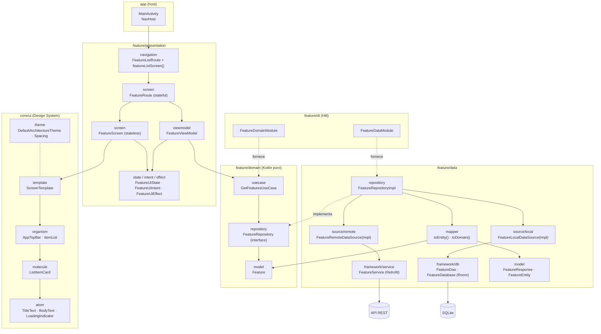

# default-architecture

Projeto Android de referência que demonstra uma arquitetura em camadas (Clean Architecture), apresentação em **MVI**, UI em **Jetpack Compose** organizada com **Atomic Design**, injeção de dependência com **Hilt** e testes em todos os níveis.

A feature de exemplo (`feature`) busca uma lista de itens em uma API, salva em um banco local e exibe numa tela — funcionando offline com o que já estiver em cache.

## Diagrama da arquitetura

As setas sólidas indicam "usa / depende de"; as tracejadas indicam implementação de interface e fornecimento via DI.



## Estrutura de pastas

Pacote base: `com.giovannicampos.defaultarchitecture`

```
├── MainActivity.kt                  # host de navegação (NavHost)
├── DefaultArchitectureApplication.kt # @HiltAndroidApp
├── core/
│   ├── common/                      # utilitários compartilhados (vazio por enquanto)
│   └── ui/
│       ├── theme/                   # tema e tokens (cores, espaçamento)
│       ├── navigation/              # navegação compartilhada (vazio por enquanto)
│       └── design/
│           ├── atom/
│           ├── molecule/
│           ├── organism/
│           └── template/
└── feature/
    ├── data/
    │   ├── framework/
    │   │   ├── db/                  # Room: DAO e Database
    │   │   └── service/             # Retrofit: interface da API
    │   ├── source/
    │   │   ├── local/               # data source local (usa o DAO)
    │   │   └── remote/              # data source remoto (usa o service)
    │   ├── repository/              # implementação do repository do domínio
    │   ├── mapper/                  # conversões entre modelos
    │   └── model/                   # FeatureResponse (API) e FeatureEntity (banco)
    ├── di/                          # módulos Hilt
    ├── domain/
    │   ├── model/                   # modelos puros
    │   ├── repository/              # contratos (interfaces)
    │   └── usecase/                 # regras de negócio
    └── presentation/
        ├── viewmodel/
        ├── model/                   # modelos específicos de UI (vazio por enquanto)
        └── ui/
            ├── screen/              # Route (stateful) + Screen (stateless)
            ├── component/           # componentes exclusivos da feature (vazio por enquanto)
            ├── navigation/          # rota e registro no NavGraph
            ├── state/
            ├── intent/
            └── effect/
```

## Conceitos

### Clean Architecture e regra de dependência

O código é dividido em três camadas, e as dependências apontam sempre para dentro, em direção ao domínio:

- **domain** — o núcleo. Contém o modelo `Feature`, o contrato `FeatureRepository` e o `GetFeaturesUseCase`. É **Kotlin puro**: não conhece Android, Room, Retrofit, Hilt nem a camada `data`.
- **data** — implementa os contratos do domínio. Conhece frameworks (Room, Retrofit, kotlinx-serialization) e converte seus modelos para os do domínio.
- **presentation** — depende apenas do domínio (use cases e modelos). Não sabe de onde os dados vêm.

A **inversão de dependência** acontece no repository: o domínio define a interface `FeatureRepository` e a camada `data` a implementa (`FeatureRepositoryImpl`). O Hilt liga uma à outra.

### Modelos por camada e mappers

Cada camada tem o seu modelo, para que mudanças em uma não vazem para as outras:

| Modelo | Camada | Papel |
|---|---|---|
| `FeatureResponse` | data | formato da API (`@Serializable`) |
| `FeatureEntity` | data | formato do banco (`@Entity`) |
| `Feature` | domain | conceito de negócio, sem anotações |

As conversões ficam em `data/mapper` (`toEntity()` e `toDomain()`), porque é a camada `data` que conhece os dois lados.

### Repository offline-first

`FeatureRepositoryImpl` coordena as duas fontes de dados:

1. busca na API (`FeatureRemoteDataSource`) e salva no banco (`FeatureLocalDataSource`);
2. se não houver rede (`IOException`), mantém o que já está salvo;
3. responde **sempre a partir do banco**, que é a fonte única de verdade.

Os detalhes de framework ficam em `data/framework` (DAO do Room e service do Retrofit); os data sources em `data/source` os encapsulam atrás de interfaces próprias.

### MVI na camada de apresentação

O fluxo é unidirecional:

```
Usuário → FeatureUiIntent → FeatureViewModel → FeatureUiState  → Screen
                                             ↘ FeatureUiEffect → Route (navegação, snackbar)
```

- **`FeatureUiState`** — tudo o que a tela mostra num instante (`isLoading`, `features`). Exposto como `StateFlow`.
- **`FeatureUiIntent`** — ações do usuário (`LoadFeatures`, `FeatureClicked`). Entram por um único ponto: `onIntent()`.
- **`FeatureUiEffect`** — eventos de disparo único (`NavigateToFeatureDetail`, `ShowLoadError`). Expostos por um `Channel`, para não se repetirem em recomposições ou rotação.

A tela é dividida em duas partes:

- **`FeatureRoute`** (stateful) — obtém o ViewModel via `hiltViewModel()`, coleta o estado com `collectAsStateWithLifecycle` e os efeitos com `repeatOnLifecycle`.
- **`FeatureScreen`** (stateless) — recebe `uiState` e `onIntent`; fácil de pré-visualizar (`@Preview`) e testar.

### Atomic Design no Design System

Os componentes reutilizáveis ficam em `core/ui/design`, organizados por nível de composição:

| Nível | Componentes | Descrição |
|---|---|---|
| Átomo | `TitleText`, `BodyText`, `LoadingIndicator` | elementos indivisíveis |
| Molécula | `ListItemCard` | combinação de átomos |
| Organismo | `AppTopBar`, `ItemList` | seções completas da interface |
| Template | `ScreenTemplate` | esqueleto da tela com slots (top bar, conteúdo, loading, snackbar) |
| Página | `FeatureScreen` | template preenchido com dados reais — fica na feature |

O Design System **não conhece as features**: `ItemList` recebe seu próprio modelo (`ItemListEntry`), e é a `FeatureScreen` que converte `Feature` para ele. Cores e espaçamentos vêm de `core/ui/theme` (`DefaultArchitectureTheme` e `Spacing`).

### Navegação

A `MainActivity` é o único host e declara o `NavHost`. Cada feature expõe:

- uma rota tipada com `@Serializable` (`FeatureListRoute`);
- uma extensão de `NavGraphBuilder` (`featureListScreen()`) que registra o destino e recebe os callbacks de navegação.

Assim a feature não conhece o `NavController` nem outras features — quem decide para onde ir é o host.

### Injeção de dependência (Hilt)

- `DefaultArchitectureApplication` com `@HiltAndroidApp` e `MainActivity` com `@AndroidEntryPoint`.
- `FeatureDataModule` — fornece Retrofit, `FeatureService`, Room e DAO, e liga as interfaces (data sources e repository) às implementações.
- `FeatureDomainModule` — fornece o `GetFeaturesUseCase`. O use case é criado no módulo (sem `@Inject`) para manter o domínio livre de anotações de framework.
- `FeatureViewModel` usa `@HiltViewModel`.

A separação entre os dois módulos permite que os testes substituam **apenas a camada de dados**.

## Testes

Todos os testes seguem **Given / When / Then**, com o corpo separado por comentários `// Given`, `// When`, `// Then`.

### Testes na JVM (`app/src/test`)

Nomes com backticks descrevendo o cenário, por exemplo:
`` `given network is unavailable, when getFeatures, then returns cached features without saving` ``

| Alvo | Ferramentas |
|---|---|
| Mappers | JUnit |
| Repository | **MockWebServer** (API simulada com Retrofit real) + **mockK** (data source local) |
| Use case | mockK |
| ViewModel | mockK + **Turbine** (Flow) + `MainDispatcherRule` |
| Screen | **Robolectric** + Compose UI Test + **Robot Pattern** (`FeatureScreenRobot`) |
| Arquitetura (`architecture/ArchitectureTest.kt`) | **Konsist** — camadas, pacotes, MVI, design system e nomes Given/When/Then |

### Testes instrumentados (`app/src/androidTest`)

Rodam em dispositivo ou emulador. Os nomes seguem `givenX_whenY_thenZ`, pois o formato DEX só aceita espaços em nomes de método a partir da API 30 (o `minSdk` é 24).

| Alvo | Ferramentas |
|---|---|
| `FeatureDaoTest` | Room em memória sobre o SQLite real |
| `FeatureFlowTest` (ponta a ponta) | Hilt (`HiltTestRunner`, `@TestInstallIn`) + Compose UI Test + Robot Pattern (`FeatureFlowRobot`) |

No teste de ponta a ponta, `FakeFeatureDataModule` substitui o `FeatureDataModule` por um `FakeFeatureRepository`; todo o resto (Activity, navegação, tela, ViewModel e use case) é real.

### O padrão Robot

Os Robots concentram *como* interagir com a tela (encontrar nós, clicar, verificar), deixando o teste focado em *o quê* está sendo verificado:

```kotlin
robot.showScreen(FeatureUiState(features = features))
robot.clickFeature("Segunda")
robot.assertIntentsSent(FeatureUiIntent.FeatureClicked(featureId = "2"))
```

## Stack

| Tecnologia | Versão |
|---|---|
| Android Gradle Plugin | 9.4.1 |
| Kotlin | 2.2.10 |
| compileSdk / targetSdk / minSdk | 37 / 37 / 24 |
| Jetpack Compose (BOM) + Material 3 | 2026.09.00 |
| Navigation Compose | 2.10.2 |
| Lifecycle (ViewModel, runtime-compose) | 2.11.0 |
| Kotlin Coroutines | 1.11.0 |
| Hilt | 2.60.1 |
| Room (com KSP) | 2.8.5 |
| Retrofit + kotlinx-serialization | 3.0.0 / 1.9.0 |
| mockK · Turbine · MockWebServer | 1.14.11 · 1.2.1 · 4.12.0 |
| Robolectric | 4.17 |
| Konsist | 0.17.3 |

As versões ficam centralizadas em `gradle/libs.versions.toml`.

## Comandos

```bash
./gradlew :app:assembleDebug               # compila o app
./gradlew :app:testDebugUnitTest           # testes na JVM (inclui Robolectric)
./gradlew :app:connectedDebugAndroidTest   # testes instrumentados (precisa de emulador/dispositivo)
```

## Pendências conhecidas

- `BASE_URL` em `FeatureDataModule` é um placeholder (`https://example.com/api/`); ao executar o app, a lista fica vazia e o snackbar de erro aparece.
- A tela de detalhe ainda não existe: o clique emite `NavigateToFeatureDetail`, mas o host não navega para lugar nenhum.
- Erros HTTP (ex.: 500) são propagados como `HttpException` em vez de cair no cache.
- O schema do Room não é exportado (`exportSchema = false`); vale habilitar antes de precisar de migrações.
